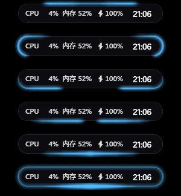
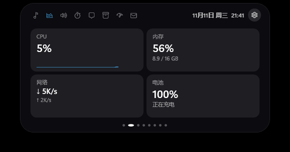
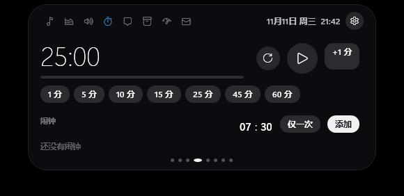
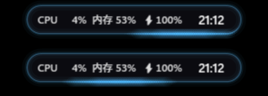
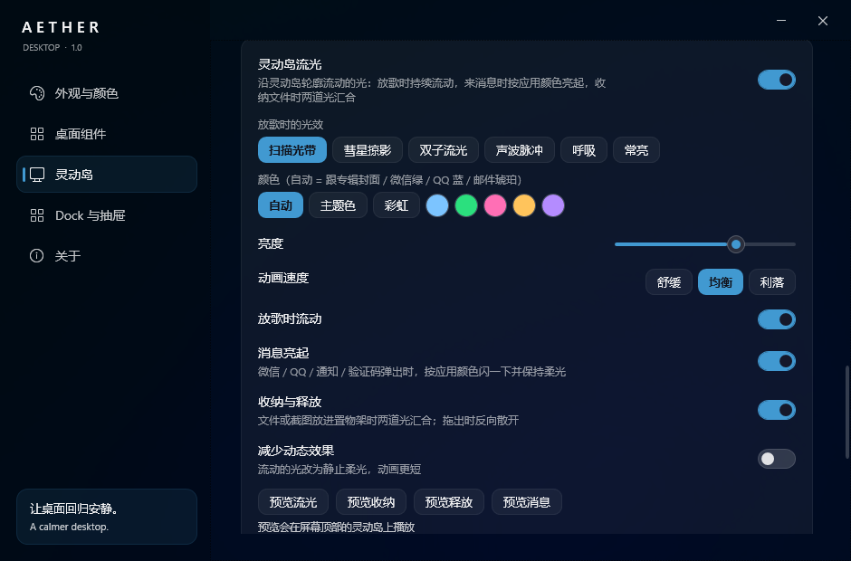
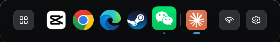

# Aether Desktop

[中文](README.md) | **English**

A nicer, handier Windows 11 desktop: a **glowing Dynamic Island** at the top, a **Dock + app drawer** at the bottom, **desktop cards** you can place anywhere, and colours that follow your wallpaper.

Lightweight: about 0.2% CPU and ~70 MB RAM at idle; everything steps aside for fullscreen games and videos.

> The interface is in Chinese for now.



---

## Install / update / uninstall

**Install**
1. Download `Aether-x.y.z.zip` from the [latest release](../../releases/latest) and unzip it anywhere
2. Run `Aether.exe` → click **安装 (Install)**
   - Installs per-user, **no admin rights needed**
   - Choose whether the Dock replaces the Windows taskbar (changeable later)
   - Or click "先不装，直接试用" to just try it without installing
3. On first run the settings window opens and colours are picked from your wallpaper

> Missing .NET? Install the **[.NET 10 Desktop Runtime (x64)](https://dotnet.microsoft.com/download/dotnet/10.0)** and run it again.

**Update**: checks for new versions automatically (1 min after start, then every 12 h). Go to **Settings › 关于 (About) › 更新**, click "更新并重启" — done in seconds, settings and data kept.

**Uninstall**: Windows Settings › Apps, the Start-menu "卸载 Aether Desktop", or Aether Settings › About › 卸载. The taskbar is restored first; you choose whether to delete your data.

**Lost your taskbar?** Start menu › Aether Desktop › "Aether 恢复任务栏（应急）" (restore taskbar).

---

## Dynamic Island

A small island at the top centre. **Hover to expand**; drag sideways to move it. Shape: notch (flush with the top edge) or floating capsule; skin: classic black or tinted by the album cover.

**Collapsed** it shows the time / the current song or **synced lyrics** / icons of apps with new messages / CPU, memory, battery (each optional).

**Expanded**, swipe or scroll between pages:

| Page | What it does |
|---|---|
| 🎵 Music | Cover, seekable progress, controls, spectrum, synced lyrics. Works with NetEase Cloud Music, QQ Music, Spotify, YouTube in the browser and more |
| 📊 System | CPU, memory, network speed, battery |
| 🔊 Controls | Volume, brightness, Wi-Fi, Bluetooth, peek at the system tray |
| ⏱ Timer | Countdown (1–60 min presets) and alarms |
| 💬 Notifications | Recent notifications: click to open the app, copy the text, **verification codes** detected (click to copy) |
| 📦 Shelf | A temporary place for files (see below) |
| 🤖 AI quota | 5-hour and weekly usage of Codex / Claude with reset times |
| ✉️ Mail | Connect a mailbox; **verification codes pop up in large type** |




**Messages** — WeChat / QQ taskbar flashes show "WeChat · new message"; click to jump back (chat content is never read). Other apps' Windows notifications show their title and text; Windows' own system toasts are filtered out.

**Shelf** — **drag files onto the island** and they get "swallowed"; drag them back out into a chat, an email or a folder whenever you need them. Screenshots taken with `Win+Shift+S` / `PrtSc` land on the shelf automatically. The clipboard tab keeps your last 30 copied texts and images (password-manager content is skipped).

**Mail codes** — QQ, 163, 126, Tencent Exmail, Gmail, Outlook / Hotmail, iCloud or any IMAP server. Use an **app password / authorization code**, not your login password (Gmail: enable 2-Step Verification, then create one at <https://myaccount.google.com/apppasswords>). Read-only; codes hide themselves after 60 s (30 s / 5 min configurable).

**AI quota** — reads the Codex (`~/.codex`) and Claude Code (`~/.claude`) sign-ins already on your PC.

**Maximized & fullscreen** — over maximized windows the island stays (or shrinks to a thin bar, if you prefer); fullscreen games and videos hide it completely.

---

## Glow & motion

Light that flows along the island's outline. Settings › 灵动岛 › **流光与动效**.



- **While music plays**: light flows around the outline in the album's colour. Six styles: scan band, comet, twin streams, sound pulse (follows the beat), breathe, steady
- **New message**: a flash, then a soft glow while the toast is up — WeChat green, QQ blue, mail amber
- **Store**: when a file or screenshot goes onto the shelf, two streams run down both sides and collide at the bottom
- **Release**: dragging a file out sends the light back up
- Colour (auto / theme / rainbow / fixed), brightness, speed (calm / balanced / snappy), per-scene switches, reduce motion, live preview buttons
- Runs only while lit; about 0.6% CPU when glowing



---

## Dock & app drawer



**Dock**
- App-drawer button, pinned apps and running windows, quick settings (Win+A) and Aether settings
- Click to launch / switch / minimize; middle-click for a new window; right-click for windows, close, unpin
- **Drag icons** to reorder; drag apps **from the drawer** — or an `.exe` / shortcut from Explorer — onto the Dock to pin them
- Hide modes: smart / auto-hide / always shown
- Icon size and **frame size** are separate; the frame can be **removed entirely** so icons float on the desktop; glass opacity and blur

**App drawer**
- Scans the Start menu and **groups apps by category** automatically
- Search by name or **pinyin initials**
- Right-click an app: pin, move to group, rename, open file location, remove
- Right-click a **group chip** to rename or delete it; drag an app onto a chip to move it there
- Adjustable tint and blur

---

## Desktop cards & colours

**Cards**: clock (many styles), calendar, weather, music, notes / to-dos (several, exportable), volume mixer, quick access — all freely draggable, layout can be locked.

**Colours**: pick from the desktop on demand (default), follow the wallpaper automatically (Wallpaper Engine supported, paused while gaming), or a fixed colour.

---

## FAQ

**Where's my taskbar?** Settings › Dock 与抽屉 › turn off "hide Windows taskbar", or use the Start-menu "restore taskbar" shortcut.

**Why no WeChat message text?** WeChat for Windows doesn't send Windows notifications, so Aether only knows *that* there's a message (from the taskbar flash). QQ shows text once its system notifications are on.

**No lyrics?** Lyrics come from LRCLIB; rare songs may be missing. For NetEase Cloud Music enable "SMTC" in its settings › system.

**Does it affect games?** With a fullscreen app in front, the island and Dock disappear, cards pause, and Aether lowers its own priority.

**Autostart?** Settings › 关于 (About): high / normal / low / off.

---

## Privacy

Everything stays on your PC (the `Data` folder next to the program). Notifications are read from the local Windows notification database; mail passwords are encrypted with Windows DPAPI. AI quota sends only your existing local sign-ins to the official endpoints (chatgpt.com / api.anthropic.com). Weather: Open-Meteo; lyrics: LRCLIB; updates: GitHub. **No analytics, no telemetry.**

## Building

Needs the .NET 10 SDK.

```powershell
.\build.ps1             # build into src\Aether\bin\Release
.\build.ps1 -Install    # install to %LOCALAPPDATA%\Programs\Aether Desktop and start (keeps Data)
```

Developer notes: [docs/HANDOFF.md](docs/HANDOFF.md) (Chinese).

## Credits

Some island interactions were inspired by the behaviour of [xiaotang-daozai](https://github.com/Renly1994/xiaotang-daozai) (MIT), [BrimDeck](https://github.com/MoFeng2223/BrimDeck) (Apache-2.0) and [fly-island](https://github.com/flyl1u/fly-island) (MIT); the verification-code scoring idea comes from xiaotang-daozai. The code is written independently.

## License

[MIT](LICENSE)
