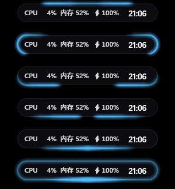
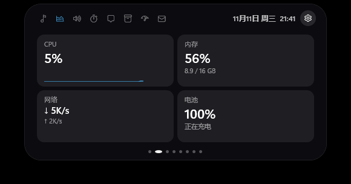
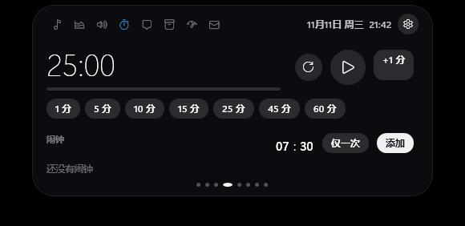
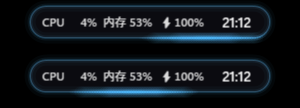
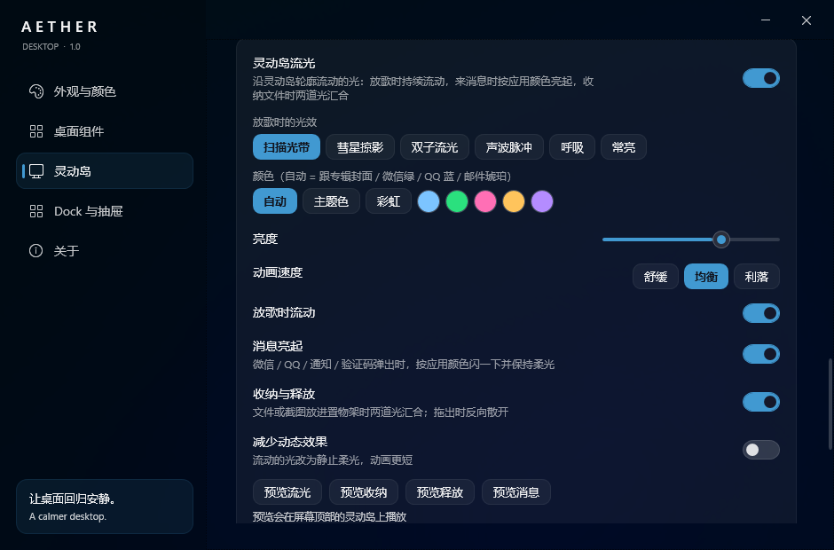
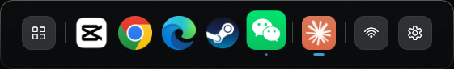

# Aether Desktop

**中文** | [English](README.en.md)

把 Windows 11 桌面变得更好看、更顺手：顶部一座会**发光**的**灵动岛**，底部一条 **Dock + 应用抽屉**，桌面上可以随意摆放的**小卡片**，配色自动跟着壁纸走。

很轻：平时整机 CPU 约 0.2%、内存约 70 MB；打游戏、看全屏视频时自动全部让开。



---

## 目录
- [安装 / 更新 / 卸载](#安装--更新--卸载)
- [灵动岛](#灵动岛)
- [流光与动效](#流光与动效)
- [Dock 与应用抽屉](#dock-与应用抽屉)
- [桌面卡片与配色](#桌面卡片与配色)
- [常见问题](#常见问题)
- [隐私](#隐私) · [自己编译](#自己编译) · [致谢](#致谢)

---

## 安装 / 更新 / 卸载

**安装**
1. 到 [Releases 最新版](../../releases/latest) 下载 `Aether-x.y.z.zip`，解压到任意位置
2. 双击 `Aether.exe`，弹出「安装 Aether Desktop」→ 点 **安装**
   - 装到你自己的用户目录，**不需要管理员权限**
   - 可以勾选「用 Dock 代替 Windows 任务栏」，之后随时在设置里改
   - 只想看看？点「先不装，直接试用」
3. 第一次运行会打开设置窗口，并自动从桌面壁纸取色

> 提示缺少 .NET？按弹窗里的链接安装 **[.NET 10 Desktop Runtime（x64）](https://dotnet.microsoft.com/download/dotnet/10.0)**，装完再打开一次。

**更新**：装好后会自己检查新版本（启动 1 分钟后，之后每 12 小时）。有新版时到 **设置 › 关于 › 更新**，点「更新并重启」，几秒钟自动换好，设置和数据都保留。

**卸载**：任选一个——Windows 设置 › 应用；开始菜单「卸载 Aether Desktop」；Aether 设置 › 关于 › 卸载。卸载会先把任务栏恢复原样，可选择是否同时删除你的数据。

**任务栏找不回来了？** 开始菜单 › Aether Desktop › 「Aether 恢复任务栏（应急）」。

---

## 灵动岛

屏幕顶部正中的小岛。**鼠标移上去展开**，按住左右拖可以换位置。形态可选「刘海（贴顶边）」或「悬浮胶囊」，皮肤可选「经典黑」或「随专辑封面变色」。

**收起时**显示：时间 / 正在播放的歌名或**同步歌词** / 有新消息的应用图标 / CPU、内存、电量（都可以在设置里开关）。

**展开后**左右滑动（或滚轮）切换页面：

| 页面 | 能做什么 |
|---|---|
| 🎵 音乐 | 封面、进度条（可拖动）、播放控制、频谱、同步歌词。支持网易云、QQ 音乐、Spotify、浏览器里的 YouTube 等 |
| 📊 系统 | CPU、内存、网速、电池 |
| 🔊 控制 | 音量、亮度、WiFi、蓝牙、临时唤出系统托盘图标 |
| ⏱ 计时 | 倒计时（1–60 分钟快捷）、闹钟；到点在岛上提醒 |
| 💬 通知 | 最近的通知：点一下打开对应软件，鼠标移上去可以「复制」，自动识别**验证码**（点一下复制） |
| 📦 置物架 | 临时放文件的地方（见下） |
| 🤖 AI 额度 | Codex / Claude 的 5 小时和每周用量、重置时间 |
| ✉️ 邮件 | 连上邮箱后自动收信，**验证码大字弹出** |




**消息提醒**
- 微信、QQ 有新消息时（任务栏图标闪烁），岛上弹出「微信 · 有新消息」，点一下切回去。不读取聊天内容。
- 其他软件的 Windows 通知会显示标题和正文；Windows 自己的系统提示（更新、安全中心等）不会打扰你。

**置物架**
- 把文件、文件夹**拖到灵动岛上**，它会自动展开并把文件「吸」进去；之后随时从岛上**拖出来**放进微信、邮件或其他文件夹。
- 用 `Win+Shift+S` 或 `PrtSc` 截图，截图会**自动放进置物架**，直接拖进聊天窗口就能发。
- **收纳窗口**：按住任意窗口的标题栏拖到灵动岛上，松手后窗口会像被吸管吸走一样扭成水滴形吸进岛里；在置物架的「窗口」标签点一下，它会反向「吐」回原来的位置。退出 Aether 时所有收纳的窗口都会自动放回。
- 「剪贴板」标签：最近复制过的 30 条文字和图片，点一下重新复制，可以固定常用的。密码管理器标记为敏感的内容不会被记录。

**邮件验证码**（设置 › 灵动岛 › 邮件与验证码）
- 支持 QQ、163、126、腾讯企业邮、Gmail、Outlook / Hotmail、iCloud 和其他 IMAP 邮箱。
- 需要的是邮箱的**授权码 / 应用专用密码**，不是登录密码：
  - QQ / 163 / 126：邮箱网页版 › 设置 › 开启 IMAP，生成授权码
  - Gmail：先开两步验证，再到 <https://myaccount.google.com/apppasswords> 生成应用专用密码
- 只读取邮件，不会发信或删改。验证码弹出后默认 60 秒自动隐藏（可改 30 秒 / 5 分钟）。

**AI 额度**：自动读取本机已登录的 Codex（`~/.codex`）和 Claude Code（`~/.claude`）。Claude 要先装 Claude Code 并登录一次。

**最大化与全屏**：窗口最大化时灵动岛照常显示（可设置为缩成一条细线）；全屏游戏、全屏视频时完全隐藏。

---

## 流光与动效

灵动岛轮廓上流动的光。设置 › 灵动岛 › **流光与动效**。



- **放歌时**：光沿着轮廓流动，颜色跟着专辑封面变。6 种样式：
  扫描光带 · 彗星掠影 · 双子流光 · 声波脉冲（跟着音乐节奏明暗）· 呼吸 · 常亮
- **来消息时**：先闪一下，弹窗期间保持柔光。颜色按应用：微信绿、QQ 蓝、邮件验证码琥珀色
- **收纳**：文件或截图放进置物架时，两道光从顶部出发沿左右两侧汇合到底部，相撞后整圈一亮
- **释放**：从置物架拖出文件时，光反向散开
- 可调：颜色（自动 / 主题色 / 彩虹 / 固定颜色）、亮度、速度（舒缓 / 均衡 / 利落）、每个场景单独开关、「减少动态效果」
- 设置里有「预览」按钮，点了在灵动岛上直接看效果
- 只在发光时才运行，平时不占资源；发光时整机 CPU 约 0.6%



---

## Dock 与应用抽屉



**Dock**（屏幕底部）
- 最左边是**应用抽屉**按钮，中间是固定的应用和正在运行的窗口，右边是网络/音量/亮度（Win+A）和 Aether 设置
- 点图标：没打开就启动，打开了就切换 / 最小化；中键新开一个；右键看所有窗口、关闭、取消固定
- **拖动图标**左右换位置；把应用从**抽屉拖到 Dock**、或从文件夹把 `.exe` / 快捷方式拖到 Dock 就能固定
- 隐藏方式：智能（窗口挡住时藏起，鼠标碰底边出现）/ 自动隐藏 / 始终显示
- 外观：图标大小、**外框大小**分开调；可以**完全去掉外框**，图标直接浮在桌面上；玻璃浓度、背景模糊

**应用抽屉**（点 Dock 最左边的按钮）
- 自动扫描开始菜单，**按类别自动分组**（游戏、社交、开发、影音……）
- 搜索支持**拼音首字母**（输入 `wx` 找到微信）
- 右键应用：固定到 Dock、移动到分组、重命名、打开文件位置、从抽屉移除
- 右键**分组标签**：改名 / 删除；把应用**拖到分组标签上**就能换组
- 抽屉的透明度和背景模糊可以调

---

## 桌面卡片与配色

**桌面卡片**（设置 › 桌面组件）：时钟（多种样式，包括手写签名风）、日历、天气、音乐、便签 / 待办（可以开多个、导出）、音量混音台、快速访问。全部可以**自由拖动**，可以锁定布局。

**配色**（设置 › 外观与颜色）三选一：
- **手动取色**（默认）：点一下「从桌面取色」
- **自动跟随**：壁纸变了自动换色（支持 Wallpaper Engine）；打游戏时暂停
- **固定颜色**：自己选

---

## 常见问题

**任务栏不见了 / 想要回来？** 设置 › Dock 与抽屉 › 关闭「隐藏 Windows 任务栏」；或开始菜单「Aether 恢复任务栏（应急）」。

**微信消息为什么看不到内容？** 微信电脑版不发 Windows 通知，Aether 只能从任务栏图标闪烁知道「有新消息」。QQ 开启系统通知后可以显示内容。

**歌词没显示？** 歌词来自 LRCLIB 在线歌词库，冷门歌曲可能没有。网易云音乐请在它的设置 › 系统里开启「SMTC」。

**会影响游戏吗？** 全屏程序在前台时，灵动岛和 Dock 完全隐藏，卡片暂停刷新，Aether 自动降低优先级。

**想开机不启动？** 设置 › 关于 里改开机启动方式（高 / 普通 / 低 / 关）。

---

## 隐私

所有数据只存在本机（安装目录的 `Data` 文件夹）：
- 通知只读本机 Windows 通知数据库；邮箱授权码用 Windows 加密（DPAPI）保存，只能在你这台电脑上解开
- AI 额度只把你本机已有的登录发给对应官方接口（chatgpt.com / api.anthropic.com）
- 天气用 Open-Meteo，歌词用 LRCLIB，更新检查用 GitHub。**没有任何统计或上报**

---

## 自己编译

需要 .NET 10 SDK。

```powershell
.\build.ps1             # 编译到 src\Aether\bin\Release
.\build.ps1 -Install    # 安装到 %LOCALAPPDATA%\Programs\Aether Desktop 并启动（保留 Data）
.\publish.ps1 -Version 1.2.3 -Notes "改了什么"   # 发布到 GitHub Releases（维护者用）
```

开发说明和后续计划见 [docs/HANDOFF.md](docs/HANDOFF.md)。

| 目录 | 内容 |
|---|---|
| `Core/` | 路径、日志、设置、安装 / 卸载、更新、开机自启 |
| `Island/` | 灵动岛、流光，以及媒体、通知、未读、置物架、剪贴板、额度、邮件等服务 |
| `Dock/` | Dock、应用抽屉 |
| `Apps/` | 应用目录、图标缓存、自动分类、拼音 |
| `Widgets/` | 桌面卡片 |
| `Shell/` · `Theme/` · `Settings/` | 桌面窗口与 DWM 效果、取色、设置窗口 |

## 致谢

灵动岛的部分交互参考了 [岛仔 xiaotang-daozai](https://github.com/Renly1994/xiaotang-daozai)（MIT）、[BrimDeck](https://github.com/MoFeng2223/BrimDeck)（Apache-2.0）和 [fly-island](https://github.com/flyl1u/fly-island)（MIT）的行为设计，验证码识别的打分思路来自岛仔；代码为独立编写。

## 许可

[MIT](LICENSE)
